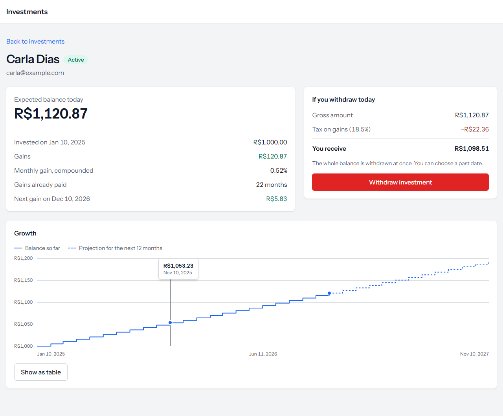

# Investments

[](https://github.com/cruzazevedorafael/fullstack-test/actions/workflows/ci.yml)

Fullstack application that stores and manages investments: create, view, list and withdraw, with compound monthly gains and regressive taxes. The original statement is in [CHALLENGE.md](CHALLENGE.md).

- **Backend:** C# / .NET 10, ASP.NET Core, EF Core, SQLite
- **Frontend:** Angular 22, TypeScript, Tailwind CSS

| List | Details |
| --- | --- |
|  |  |

More images in [screenshots](screenshots).

## Running

Requirements: Git, [.NET 10 SDK](https://dotnet.microsoft.com/download/dotnet/10.0) and Node.js 24.15 or newer. No database to install: the SQLite file is created on the first run.

The code is in the `development` branch:

```bash
git clone -b development https://github.com/cruzazevedorafael/fullstack-test.git
cd fullstack-test
```

API, at <http://localhost:5018>:

```bash
cd backend
dotnet run --project src/Investments.Api --launch-profile http
```

UI, at <http://localhost:4200>, in another terminal opened in the `fullstack-test` folder:

```bash
cd frontend
npm ci
npm start
```

Tests:

```bash
cd backend && dotnet test
cd frontend && npm test -- --watch=false
```

Both suites and the production build of the UI also run on GitHub Actions at each push and pull request.

## API documentation

With the API running:

- Navigable documentation: <http://localhost:5018/docs>
- OpenAPI document: <http://localhost:5018/openapi/v1.json>

| Method | Route | Purpose |
| --- | --- | --- |
| `GET` | `/api/owners` | List people |
| `POST` | `/api/owners` | Register a person |
| `GET` | `/api/rules` | View the gain and tax rates in use |
| `GET` | `/api/investments/summary?ownerId=&from=&to=` | Total balance of the active investments |
| `GET` | `/api/investments?ownerId=&from=&to=&status=&sortBy=&sortDirection=&page=1&pageSize=10` | List investments, with optional filters and order |
| `GET` | `/api/investments/simulation?amount=&creationDate=&months=` | Simulate a withdrawal after some months, without creating anything |
| `POST` | `/api/investments` | Create an investment |
| `GET` | `/api/investments/{id}` | View initial amount, gains, expected balance, next gain and a withdrawal today |
| `GET` | `/api/investments/{id}/growth` | Balance after each monthly gain and a 12-month projection |
| `GET` | `/api/investments/{id}/withdrawal-preview?date=` | Simulate a withdrawal |
| `POST` | `/api/investments/{id}/withdrawal` | Withdraw |

Errors follow RFC 9457 (`application/problem+json`): `400` for invalid data or broken rules, `404` for unknown resources and `409` for conflicts, such as a second withdrawal. Business errors also carry a stable `code`.

## Structure

```
backend/
  src/Investments.Domain   business rules, without database or HTTP
  src/Investments.Api      endpoints, persistence, notifications
  tests/                   unit tests (Domain) and end-to-end API tests (Api)
frontend/
  src/app/core             API access, configuration, error messages
  src/app/features         screens
  src/app/shared           reusable components
```

The two projects are deployed independently. The UI reads the API address from `config.json` when it starts, so the same build works in any environment. The API reads the allowed UI origins from `Cors:AllowedOrigins`.

## How the tools were chosen

- **C# / .NET 10 and ASP.NET Core:** C# was requested. .NET 10 is the current LTS.
- **EF Core + SQLite:** migrations and persistence with no database to install, so the API runs with a single command.
- **Angular 22 + TypeScript:** "Angular.JS + TypeScript" was requested and read as current Angular.
- **Tailwind CSS + Angular CDK:** layout based on the Figma reference, with accessible dialogs from the CDK instead of a full component library.
- **No chart library:** there is a single line chart, drawn as SVG by a small component.
- **Scalar + OpenAPI:** documentation generated from the code and navigable in the browser.
- **xUnit and Vitest:** default test tools of current .NET and Angular.

## Decisions

The statement leaves some points open. These are the choices made. The business rules are covered by tests.

| Point | Decision |
| --- | --- |
| Money | `decimal` everywhere. The balance is calculated at full precision and rounded to cents only at the end, half away from zero. |
| Monthly gain | Paid on each monthly anniversary. Partial months pay nothing. |
| Created on the 29th, 30th or 31st | In shorter months the gain is paid on the last day. |
| Tax brackets | Based on the age on the **withdrawal date**. Exactly one year and exactly two years both pay 18.5%. |
| Stored or calculated | The balance of an active investment is always calculated. Withdrawal values are stored, so past withdrawals don't change if a rate changes. |
| Today | Calendar day in São Paulo (`BusinessTimeZone`), regardless of the server time zone. |
| Amount | Greater than zero, at most two decimal places, up to 999,999,999,999.99. Together with the minimum date (1900-01-01), this keeps the compound gain inside the range of `decimal`. |
| Double withdrawal | Refused with `409`, including simultaneous requests (optimistic concurrency). |
| List | The API asks for a person's list and the UI for all investments, so the filter by person is optional. |
| Sorting | By date, amount or owner. Not by balance, because it is calculated and not stored. |
| Layout | Screens, structure and colors follow the Figma reference, seen only as a low-resolution preview. The owner column, the tax preview, the details screen, the dark theme and the phone layout are additions. |
| Total balance | Adds only active investments. It follows the person and period filters, not the status one. |
| Beyond the statement | Simulation, growth chart, status filter and sorting. Projections use the current rate and nothing simulated is stored. |
| Rates | Configurable in `appsettings.json`, section `InvestmentRules`. |
| Notifications | Sent on creation and withdrawal. They are only logged until `Smtp:Host` is configured. A failure never undoes the operation. |
| Angular | "Angular.JS + TypeScript" was read as current Angular, since AngularJS 1.x reached end of life. |

## Third-party libraries

| Library | Why |
| --- | --- |
| Entity Framework Core + SQLite | Persistence and migrations with nothing to install |
| Microsoft.AspNetCore.OpenApi | Generates the OpenAPI document from the code |
| Scalar.AspNetCore | Navigable API documentation |
| xUnit, Microsoft.AspNetCore.Mvc.Testing | Unit tests and tests against the real API in memory |
| coverlet.collector | Test coverage collector included in the xUnit template |
| Angular CDK | Accessible dialogs (focus trap, Escape, ARIA) without imposing a look |
| Tailwind CSS | Styling |
| Instrument Sans (Fontsource) | Self-hosted font, with no external requests |
| Vitest, jsdom | Frontend tests |
| Prettier | Frontend formatting |

## Known limitations

- If the rate changes, active investments are recalculated from the start with the new rate. The growth chart of a withdrawn investment is too, although its stored values don't change.
- The total balance is added up in memory, because balances are calculated. A large base would need a cached total.
- Sorting by owner ignores case, but places accented initials after Z (SQLite collation).
- There is no authentication: anyone with access to the API sees every investment.
- The list of people is not paginated.
- Migrations run when the API starts, which suits a single instance only.
- E-mails are sent during the request, with a five-second limit. A real system would use a queue.
